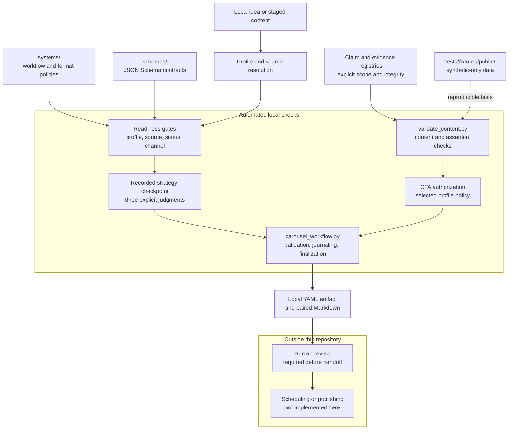
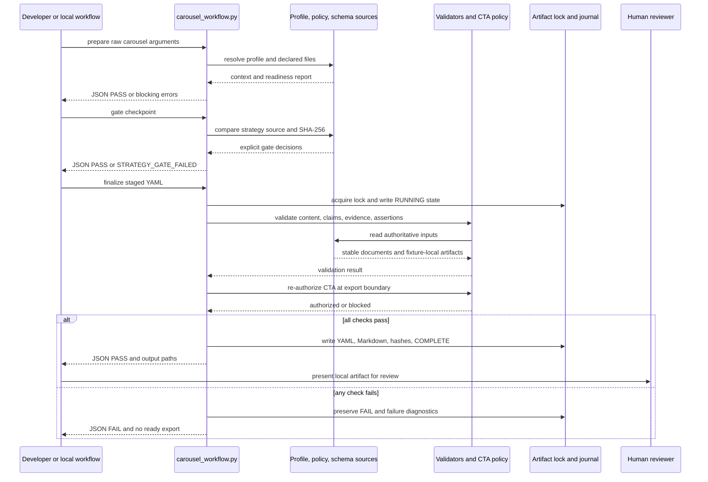

# Mustafa Content OS Ω

**A local, profile-driven content workflow foundation for deterministic
validation, explicit claim boundaries, and human-reviewed handoffs.**

## Table of contents

- [Overview](#overview)
- [Key capabilities](#key-capabilities)
- [End-to-end workflow](#end-to-end-workflow)
  - [Public, fixture-based workflow](#public-fixture-based-workflow)
  - [Profile-aware carousel workflow](#profile-aware-carousel-workflow)
  - [Interpreting results](#interpreting-results)
- [System architecture](#system-architecture)
- [Repository map](#repository-map)
- [Prerequisites and installation](#prerequisites-and-installation)
- [Running the project](#running-the-project)
- [Testing and verification](#testing-and-verification)
- [Privacy, safety, and human oversight](#privacy-safety-and-human-oversight)
- [Docker](#docker)
- [Limitations and roadmap](#limitations-and-roadmap)
- [Contributing, license, and project status](#contributing-license-and-project-status)
- [Further documentation](#further-documentation)

## Overview

Creator-content workflows often combine source context, copy, factual claims,
approval state, and publishing intent in one unstructured step. That makes it
easy to guess missing context, repeat an unsupported statement, or blur the
boundary between a local draft and a publication-ready handoff.

Mustafa Content OS addresses that problem with a local Python workflow. It
keeps creator-specific sources separate from reusable system policies, checks
machine-readable data against explicit contracts, binds factual assertions to
declared claims and evidence, and requires a separate human review boundary
before any scheduling or publishing handoff.

The intended users are developers and content-operations teams who need a
reviewable foundation for profile-driven content work. The practical value is
not automatic publishing. It is predictable failure behavior, visible source
scope, reproducible checks, and a clear distinction between what the tooling
can validate and what a person must still decide.

### Current implementation scope

This repository is the privacy-safe public submission copy. It contains:

- Python validators and workflow orchestration code.
- JSON Schema contracts for profile, content, claim, evidence, approval, and
  handoff-related records.
- Reusable system policies for voice, carousel format, design, and hook review.
- An incomplete creator-profile template.
- Synthetic public fixtures and a standard-library `unittest` suite.
- Documentation of the verified workflow and its environment limitations.

The checkout intentionally does **not** contain a real active profile, private
creator data, real drafts, private evidence, rendered exports, or publishing
credentials. It also does not contain a server, renderer, scheduler, or social
publishing integration. The public demo therefore exercises the validators
against synthetic fixtures; the profile-aware workflow is implemented for a
workspace that supplies its own authoritative profile and source files.

## Key capabilities

### Implemented

- **Safe YAML and JSON loading.** The loaders reject duplicate mapping keys
  instead of silently allowing a later value to overwrite an earlier one.
- **Schema validation.** Validators use JSON Schema contracts for content and
  registry structures, including required fields, types, enums, formats, and
  unique record IDs.
- **Claim registry checks.** `validate_claim_registry.py` checks the claim
  registry's structure, duplicate IDs, duplicate keys, and date-time format. It
  does not prove that a claim is true.
- **Evidence registry checks.** `validate_evidence_registry.py` checks profile
  scope, claim-to-evidence references, repository containment, SHA-256 hashes,
  and JSON Pointer selectors. These checks establish declared integrity and
  linkage, not independent authenticity or truth.
- **Content validation.** `validate_content.py` checks content metadata,
  profile scope, claim/evidence references, assertion targets and exact text
  spans, public-use restrictions, and CTA authorization where applicable.
- **Typed assertion applicability.** Public factual copy must be explicitly
  classified. The validator checks whether the attached claim type, subject,
  approved statement, temporal scope, attribution, and (for results) structured
  measurement can support the exact rendered text.
- **Readiness gates.** `carousel_workflow.py` resolves the selected profile,
  required sources, system policies, status, channel, and configured strategy
  before a workflow can continue. Public readiness is stricter than private
  drafting readiness.
- **Recorded strategy gate.** A checkpoint must match the selected profile and
  idea, contain the current strategy source checksum, and explicitly pass the
  `non_obvious`, `one_of_none`, and `highly_tactical` judgments with reasons.
  This is a required recorded judgment, not an automatic originality or NLP
  evaluator.
- **Configured CTA authorization.** Structured CTA mechanics are authorized
  from the selected profile's policy, including mechanic, keyword, offer,
  destination, delivery asset, conversion path, and account. A claim or a
  piece of prose cannot create CTA permission.
- **Fail-closed artifact finalization.** Finalization writes a YAML artifact and
  paired Markdown output only after validation and CTA authorization pass. It
  fingerprints authoritative inputs, uses a POSIX lock and journal, preserves
  terminal failures, and revokes a ready state when a later check fails.
- **Reproducible public checks.** The locked dependencies, pinned interpreter,
  synthetic fixtures, and test suite provide a clean-machine validation path.

### Intentionally outside the implementation

The repository does not currently render images, schedule posts, publish to
Instagram or another platform, import analytics, verify the truth of a claim,
or record a human approval event. The `approval.schema.json`, render,
scheduling, and publication schemas define possible record shapes, but their
corresponding integrations are not wired into the executable workflow.

The `.claude/commands/` files describe slash-command operating instructions.
They are not an application-side content generator, hook scorer, renderer, or
scheduler client. In particular, `/schedule` is a documented handoff only.

## End-to-end workflow

There are two useful paths through this repository:

1. The **public fixture-based path**, which runs directly from this clean
   submission checkout.
2. The **profile-aware carousel path**, which is implemented by the workflow
   CLI but requires a workspace containing an active profile, authoritative
   sources, registries, and content artifacts. Those creator-specific files
   are intentionally omitted here.

### Public, fixture-based workflow

Run the following commands from the repository root after installation.

#### 1. Validate the synthetic claim registry

```bash
python -B scripts/validate_claim_registry.py \
  tests/fixtures/public/knowledge/claims.yaml
```

This is a read-only structural check. A successful run prints:

```text
VALID claim registry (structure and unique IDs only; not proof verification)
```

An invalid registry prints `INVALID claim registry` to standard error and exits
with status `1`.

#### 2. Validate the synthetic evidence registry

```bash
python -B scripts/validate_evidence_registry.py \
  tests/fixtures/public/knowledge/evidence.yaml \
  --claims tests/fixtures/public/knowledge/claims.yaml \
  --repository-root tests/fixtures/public
```

This checks the evidence schema, claim references, fixture-local artifact
containment and hashes, and JSON Pointer selectors. A successful run prints:

```text
VALID evidence registry (structure, artifact integrity, and claim references; not proof verification)
```

#### 3. Validate one synthetic public content item

```bash
python -B scripts/validate_content.py \
  tests/fixtures/public/content/valid.yaml \
  --mode public \
  --format human \
  --claims tests/fixtures/public/knowledge/claims.yaml \
  --evidence tests/fixtures/public/knowledge/evidence.yaml \
  --repository-root tests/fixtures/public
```

The human-readable result begins with `PASS` when the fixture satisfies the
declared checks. The content validator also supports `--format json`, which
returns a structured result containing fields such as `valid`, `result`,
`continue`, and `errors`. `PASS` means the declared structural and scope checks
passed; it does not mean that a person approved the item or that the claim was
independently verified.

#### 4. Run the complete public suite

```bash
python -B -m unittest discover -s tests -p 'test_*.py'
```

The suite exercises profile readiness, content validation, claim and evidence
registries, assertion applicability, CTA authorization, input-change handling,
and terminal artifact states. The verified suite contains 242 tests and should
finish with `OK` in an environment with the locked dependencies installed.

### Profile-aware carousel workflow

The executable workflow entry point is:

```bash
python -B scripts/carousel_workflow.py COMMAND [OPTIONS]
```

It has three subcommands. These are the real parser interfaces; they are shown
here so a workspace owner can use the implementation without treating the
slash-command documents as an executable API.

#### Prepare a request

```bash
python -B scripts/carousel_workflow.py prepare \
  "--profile PROFILE_ID IDEA" \
  --mode draft \
  --platform instagram \
  --pillar PILLAR
```

`arguments` is one quoted string containing the raw `/carousel` arguments.
`--mode` accepts `draft`, `review`, `approved`, or `public`; `--platform`
defaults to `instagram`; and `--pillar` accepts an explicit active pillar ID or
exact configured name. The command resolves the active profile and sources,
checks required system files and readiness, and prints a JSON report. In this
public checkout it cannot complete against the default paths because
`profiles/active.yaml` and the real creator source tree are intentionally not
included.

#### Check the strategy checkpoint

```bash
python -B scripts/carousel_workflow.py gate CHECKPOINT \
  --mode draft \
  --platform instagram
```

`CHECKPOINT` is a path to the recorded strategy checkpoint. The checkpoint must
match the selected profile and idea, reference the current strategy source and
SHA-256, and explicitly pass all three strategy judgments. The command prints a
JSON report and exits nonzero when the gate fails.

#### Finalize a content artifact

```bash
python -B scripts/carousel_workflow.py finalize CONTENT_YAML \
  --strategy CHECKPOINT \
  --notes BUILD_NOTES \
  --status draft
```

`CONTENT_YAML` must be a dated artifact directly under
`content/carousels/` with the form `YYYY-MM-DD-<slug>.yaml`; its `content_id`
must match the filename stem. `--strategy`, `--notes`, and `--status` are
optional parser arguments. The status choices are `draft`, `review`,
`approved`, `public`, and `killed`.

On a successful finalization, the workflow writes the YAML artifact and a
paired Markdown file. It also records a workflow journal under
`content/carousels/.workflow-state/`. On failure, the workflow returns a JSON
diagnostic, keeps the source in a non-ready state, may write a
`.validation-failure.json` record, and refuses unsafe retries for a terminal
artifact state. Finalization is the one executable path in this repository that
writes workflow artifacts; the registry and content validators are read-only.

### Interpreting results

- A validator exit status of `0` means its explicit checks passed. A status of
  `1` means the input is invalid, incomplete, unauthorized, or could not be
  loaded.
- `PASS` and `valid: true` describe the validator's declared checks only.
  They are not proof of factual truth, human approval, or publication.
- `FAIL`, `continue: false`, and the returned error codes identify the stage
  that blocked continuation. Common boundaries include missing profile sources,
  stale strategy checksums, unsupported assertion text, insufficient evidence,
  unauthorized CTA mechanics, and changed authoritative inputs.
- A local `approved` or `public` content status is an artifact state accepted by
  the local workflow. It is not a call to a platform and does not publish the
  content.

## System architecture

The first diagram shows the verified components and their trust boundaries.



The runtime/data flow below focuses on the order of checks for a profile-aware
run. A failure at a validation boundary returns diagnostics and stops the
export path.



### Component responsibilities and data flow

1. `carousel_workflow.py` resolves a profile context and reads the declared
   source files. It checks readiness before generation or public use.
2. `systems/` supplies reusable workflow, voice, design, carousel-type, and
   hook-rubric policies. These policies do not supply creator identity, offers,
   metrics, or proof.
3. `schemas/` supplies machine-readable contracts. The active validators use
   the active-profile, creator-profile, content-item, claim-registry, and
   evidence-registry contracts. Approval, render, schedule, and publication
   schemas are present as contracts but are not connected to an integration.
4. `validate_content.py` validates the content item and checks exact rendered
   copy fields (`hook`, `caption`, `cta`, and slide fields) against explicit
   assertion bindings. It does not extract facts from prose.
5. `validate_claim_registry.py` and `validate_evidence_registry.py` validate
   declared records and local integrity relationships. Registry membership is
   not independent fact verification.
6. CTA authorization reads the selected profile's authoritative configuration
   separately from claims. This prevents a claim or generated sentence from
   authorizing a destination, offer, keyword, or delivery path.
7. The finalizer snapshots authoritative inputs before and after validation and
   before export. `artifact_state.py` provides canonical-path checks, POSIX
   locking, atomic journal writes, and output hashes.
8. Human review is the final boundary shown in the architecture. The repository
   does not capture the review decision or perform the subsequent scheduling or
   publication action.

## Repository map

All paths below exist in this submission repository unless explicitly described
as a path that a consuming workspace must provide.

| Path | Purpose |
|---|---|
| `scripts/validate_claim_registry.py` | Read-only claim-registry loader and schema/ID/date checks. |
| `scripts/validate_evidence_registry.py` | Read-only evidence checks for scope, references, containment, hashes, and selectors. |
| `scripts/validate_content.py` | Content schema, scope, assertion applicability, public-use, and CTA validation. |
| `scripts/carousel_workflow.py` | `prepare`, `gate`, and `finalize` workflow CLI; readiness, strategy, validation, and artifact state. |
| `scripts/artifact_state.py` | Canonical artifact paths, POSIX locking, atomic journal writes, and output hashes. |
| `scripts/requirements-claims.txt` | Existing compatible dependency-range file for the original claim tooling; use `requirements.lock` for this submission's reproducible install. |
| `schemas/` | JSON Schema contracts for active profiles, creator profiles, content, registries, and future handoff records. |
| `schemas/README.md` | Contract and authority notes. Some historical statements there describe an earlier phase; the executable validators listed above are the current implementation. |
| `systems/brand-voice.md` | Reusable voice policy. |
| `systems/carousel-design-system.md` | Reusable carousel design and export policy. |
| `systems/carousel-types.md` | Carousel type definitions and structures. |
| `systems/hook-rubric-20pt.md` | Hook review rubric used as a policy source. |
| `profiles/_template/` | Creator-agnostic profile scaffold with intentionally unresolved placeholders. |
| `profiles/README.md` | Profile authority and mode guidance. The active creator profiles described there are not included in this public copy. |
| `tests/` | `unittest` modules covering validators, readiness, applicability, CTA authorization, and workflow integration. |
| `tests/fixtures/public/` | Clearly labeled synthetic profile, registry, repository, content, and carousel fixtures. |
| `tests/fixtures/content/unknown-claim.yaml` | A non-public-fixture negative content case used as a test input. |
| `.claude/commands/` | Instruction documents for `/carousel`, `/hooks`, and `/schedule`; not executable integrations. |
| `.python-version` | Pins CPython `3.11.2`. |
| `requirements.lock` | Exact Python dependency versions for the public checks. |
| `Dockerfile` | Intended locked test image; its application build is host-limited in the documented environment. |
| `.dockerignore` | Keeps private/generated paths and local credentials out of the Docker build context. |
| `README.md` | This project guide. |
| `docs/architecture.md` | Concise architecture and trust-boundary description. |
| `docs/buildathon-project.md` | Problem, implementation scope, and safety model. |
| `docs/demo-script.md` | Copy-paste public fixture validation commands. |
| `docs/verification.md` | Recorded verification results and Docker host limitation. |
| `archives/README.md` | Documentation for the archive location in a consuming content workspace. |
| `LICENSE` | Existing MIT License; preserved unchanged. |

The clean public checkout does **not** contain `profiles/active.yaml`,
`profiles/manthan/`, `profiles/mustafa/`, `knowledge/`, `content/carousels/`,
`references/`, rendered exports, or internal reports. The tests create isolated
temporary repositories from the public fixtures when they need those paths.

## Prerequisites and installation

The supported environment is Linux with **CPython 3.11.2**. The exact version
is recorded in `.python-version`. The project uses `venv` and `pip`; no global
Python package installation is required.

From the repository root:

```bash
python3.11 --version
python3.11 -m venv .venv
. .venv/bin/activate
python -m pip install --requirement requirements.lock
```

The version check should report `Python 3.11.2`. The lockfile installs:

- `PyYAML==6.0.2`
- `jsonschema==4.23.0`
- `attrs==24.2.0`
- `jsonschema-specifications==2024.10.1`
- `referencing==0.35.1`
- `rpds-py==0.20.1`

The Python workflow does not require environment variables or credentials. If
CPython 3.11.2 is not already available, install that interpreter through the
Linux host's normal version-management process before creating the virtual
environment. The application code itself does not require Docker for the local
fixture workflow.

## Running the project

After installation, activate the virtual environment and run commands from the
repository root. The most direct supported run is the public demo sequence in
[Public, fixture-based workflow](#public-fixture-based-workflow), or the same
commands in [`docs/demo-script.md`](docs/demo-script.md).

### Check dependency consistency

```bash
python -m pip check
```

This asks `pip` to report incompatible installed requirements. It does not run
the application or the tests.

### Check Python syntax

```bash
python -m compileall -q scripts tests
```

This compiles the repository's Python scripts and tests without running the
workflow. A nonzero result indicates a syntax or import-compilation problem.

### Run the read-only validators

Use the explicit fixture paths shown below because the clean submission copy
does not contain the default `knowledge/` or profile paths used by the scripts:

```bash
python -B scripts/validate_claim_registry.py \
  tests/fixtures/public/knowledge/claims.yaml

python -B scripts/validate_evidence_registry.py \
  tests/fixtures/public/knowledge/evidence.yaml \
  --claims tests/fixtures/public/knowledge/claims.yaml \
  --repository-root tests/fixtures/public

python -B scripts/validate_content.py \
  tests/fixtures/public/content/valid.yaml \
  --mode public \
  --format human \
  --claims tests/fixtures/public/knowledge/claims.yaml \
  --evidence tests/fixtures/public/knowledge/evidence.yaml \
  --repository-root tests/fixtures/public
```

The command-line interfaces also accept these flags:

| Script | Interface |
|---|---|
| `validate_claim_registry.py` | `[registry]` where the optional positional path defaults to `knowledge/claims.yaml`. |
| `validate_evidence_registry.py` | `[evidence]`, `--claims CLAIMS_PATH`, and `--repository-root ROOT`. Optional evidence defaults to `knowledge/evidence.yaml`. |
| `validate_content.py` | `CONTENT`, `--mode {draft,review,approved,public}`, `--format {human,json}`, `--claims CLAIMS_PATH`, `--evidence EVIDENCE_PATH`, `--repository-root ROOT`, and `--profile PROFILE`; the expected profile defaults to `mustafa`. |
| `carousel_workflow.py prepare` | `arguments`, `--mode {draft,review,approved,public}`, `--platform PLATFORM`, and `--pillar PILLAR`. |
| `carousel_workflow.py gate` | `checkpoint`, `--mode {draft,review,approved,public}`, and `--platform PLATFORM`. |
| `carousel_workflow.py finalize` | `content`, `--strategy STRATEGY`, `--notes NOTES`, and `--status {draft,review,approved,public,killed}`. |

The workflow CLI prints JSON. The validators print human-readable diagnostics
unless the content validator is given `--format json`. `carousel_workflow.py`
returns success only for an authoritative pass; it returns nonzero for a
blocked readiness, strategy, validation, CTA, or finalization result.

### Supplying a profile-aware workspace

The profile-aware workflow expects a consuming workspace to provide the paths
declared by its profile manifest, including an active profile selector,
creator-specific sources, and, for structured profiles, claim and evidence
registries. Copying the incomplete template alone is not enough: it contains
`PROFILE_ID`, `TODO_VERIFY`, empty catalog sections, and no usable CTA policy.

The repository therefore documents the interfaces without pretending that the
public submission checkout has an active creator context. The integration tests
demonstrate the workflow by copying synthetic fixtures into temporary
directories and completing only the fixture configuration needed for each test.

## Testing and verification

### Test commands

Run these commands from the repository root with the virtual environment
activated:

```bash
python -m pip check
python -m compileall -q scripts tests
python -B -m unittest discover -s tests -p 'test_*.py'
```

The complete public suite covers:

- profile and carousel readiness checks;
- content schema and reference validation;
- duplicate-safe claim registry loading;
- evidence scope, hashes, containment, and selector checks;
- assertion applicability and exact copy binding;
- CTA authorization from profile configuration;
- input-change detection and fail-closed finalization;
- artifact locks, journals, output state, and terminal failure behavior.

The recorded verification result is **242 tests**, finishing with `OK`, after
installing `requirements.lock` in a clean CPython 3.11.2 environment. The
current repository record is in [`docs/verification.md`](docs/verification.md).
The test count is evidence about this checked version of the suite, not a claim
that every future checkout will contain the same number of tests.

### What these checks do not prove

The checks do not prove the truth or authenticity of a claim, the identity or
authorship of a creator, the quality of a project, the validity of a metric or
testimonial, or the success of a future publication. They do not perform
natural-language truth detection. A validator `PASS` is a structural and
declared-scope result, not human approval or platform permission.

## Privacy, safety, and human oversight

This public repository is deliberately a submission copy rather than a mirror
of a private creator workspace.

- Real profiles, creator identity data, private drafts, private registries,
  evidence, protected date-specific artifacts, renders, reports, and
  credentials are excluded.
- `tests/fixtures/public/` states explicitly that its names, profile IDs,
  claims, evidence, URLs, offers, and content are synthetic. They represent no
  real person, project, result, customer, or draft.
- `.dockerignore` excludes credentials, caches, generated outputs, private
  knowledge, private profiles, references, and content-carousels paths from the
  Docker context.
- Unknown or unresolved values remain blockers. The validators do not infer
  creator facts to make a workflow pass.
- The registry and content validators are read-only. Finalization is the
  documented exception because it intentionally writes the local YAML/Markdown
  artifact, journal, and failure record described above.
- Human review remains outside the automated validator and is required before a
  scheduling or publishing handoff. The local `approved` and `public` statuses
  do not record a reviewer and do not contact a publishing platform.
- Public fixture content must not be reused as real publication content.

The safety model is summarized in [`docs/buildathon-project.md`](docs/buildathon-project.md)
and [`docs/architecture.md`](docs/architecture.md). Private information cannot
be reconstructed from the public fixtures.

## Docker

The `Dockerfile` describes the intended reproducible test-container workflow:

```bash
docker build --tag mustafa-content-os:local .
docker run --rm mustafa-content-os:local
```

The image uses `python:3.11.2-slim-bullseye`, installs
`requirements.lock`, copies the privacy-safe repository as an unprivileged
`app` user, and runs:

```text
python -B -m unittest discover -s tests -p test_*.py
```

It does not start an application server or publishing service.

### Host-specific Docker limitation

In the recorded verification environment, the Docker daemon and a `FROM
scratch` control build worked, but the application build could not restore a
base-image layer. It failed with:

```text
failed to register layer: ApplyLayer exit status 1
lchown /etc/gshadow: invalid argument
```

The same ownership-restoration failure occurred with the original Debian slim
base and with a temporary Alpine base. This is a host filesystem/container
runtime limitation, not an application test failure. The application image
build and `docker run` path therefore remain **unverified as successful** in
that environment. The Dockerfile has not been weakened to hide the limitation.

## Limitations and roadmap

### Current limitations

- The public checkout has no active creator profile or private knowledge tree,
  so profile-aware default paths are not runnable without supplying a separate
  consuming workspace.
- The profile template is intentionally incomplete and contains unresolved
  placeholders. It is a scaffold, not a ready profile.
- Claim and evidence checks validate declared structure, linkage, local file
  integrity, and applicability. They do not independently verify truth or
  authenticity.
- The strategy gate checks recorded judgments and a source checksum. It does
  not automatically assess originality, novelty, or tactical quality.
- The workflow emits content artifacts but does not render visual assets.
- Scheduling, publication, analytics, and platform APIs are not implemented.
- Human approval is a required process boundary but is not captured or
  enforced as an approval record by the executable workflow.
- The documented Docker host limitation prevents a successful container
  verification in the affected environment.

### Potential future improvements

These are possibilities, not current capabilities or promises of completed
work:

- Add a separately configured renderer and render-manifest flow.
- Add an explicit human-approval record and a review interface.
- Add platform-specific scheduling and publication adapters with real
  confirmation handling.
- Add analytics import and reporting with its own evidence boundaries.
- Expand independent environment coverage for Docker and the supported Python
  installation path.

## Contributing, license, and project status

Contributions should preserve the repository's privacy boundary and fail-closed
behavior. Keep creator-specific data out of the public fixtures, use synthetic
fixtures for new public tests, update documentation when behavior changes, and
run the locked dependency check, syntax check, and test suite before opening a
change.

This repository is a **local validation/workflow foundation**, not a deployed
content-publishing application. Its public status should be judged by the
checks and scope described here, not by an implied live service.

The existing [`LICENSE`](LICENSE) is the **MIT License** and is preserved
unchanged. Its permission notice and copyright notice apply to copies and
substantial portions of the software as stated in that file.

## Further documentation

- [`docs/architecture.md`](docs/architecture.md): component responsibilities
  and trust boundaries.
- [`docs/buildathon-project.md`](docs/buildathon-project.md): problem statement,
  implementation scope, and safety model.
- [`docs/demo-script.md`](docs/demo-script.md): verified public fixture
  commands and expected results.
- [`docs/verification.md`](docs/verification.md): recorded 242-test result,
  clean-clone verification, and Docker host limitation.
- [`profiles/_template/`](profiles/_template/): creator-agnostic profile
  scaffold; replace placeholders only in a separate authorized workspace.
- [`tests/fixtures/public/README.md`](tests/fixtures/public/README.md):
  synthetic-fixture boundary and usage warning.
